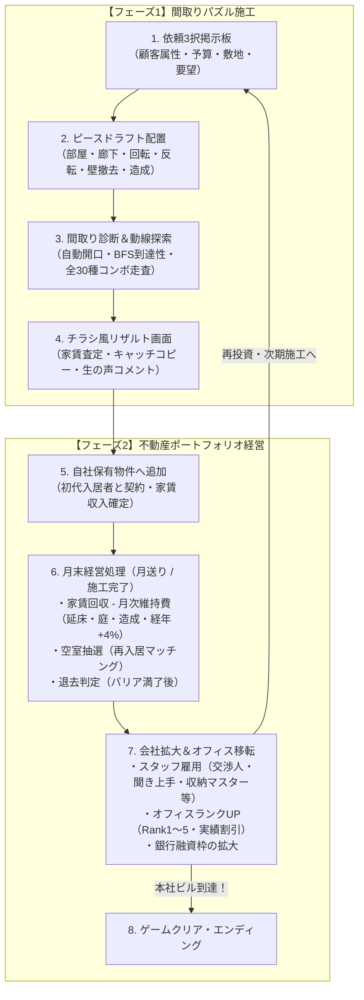

# 【GDD】間取り図作成パズル＆不動産経営 仕様設計書 (v1.0最新版)

## 1. プロジェクト概要

* **ジャンル**: 間取り構築パズル × 不動産会社経営シミュレーション
* **現行プラットフォーム**: Webブラウザ（HTML5 / Tailwind CSS / Vanilla JS 単一ファイルSPA `index.html`）
  * ※将来的なネイティブ展開（Godot 4.x 等）を視野に入れた明確なロジック・データ分離アーキテクチャ
* **ターゲット層**: 間取り・建築好き、パズルゲームファン、不動産・経営ゲームファン、SNSで珍間取りを共有したいカジュアル層
* **ビジュアルスタイル**: 不動産チラシ風・建築青図スタイル（白地×黒線×アクセントカラー）

---

## 2. コアコンセプト

家具を配置するインテリアゲームではなく、**「壁・部屋・ドア・動線」という間取り図そのものを構築する面白さ**と、**完成した物件を保有・賃貸経営して会社を急成長させる面白さ**の融合。

1. **2つの攻略アプローチ**:
   * **堅実な建築士ルート**: 生活動線や採光を突き詰めた「住みやすい理想の間取り」で高満足度・長期安定家賃を狙う。
   * **狂気の空間デザイナールート**: 要望をあえて無視し、トイレビュッフェや無限回廊、もはや公園などの「珍間取りコンボ」で爆発的な初期家賃・売却益を叩き出す。
2. **敷地パズルと造成戦略**:
   * 変形敷地や障害物（✕マス）をどう活かすか。費用を払って敷地を造成（拡張）するか、余白を「庭」として残すかのトレードオフ。
3. **不動産経営と会社拡大**:
   * 家賃収入でオフィスを移転（雑居ビル $\to$ 自社ビル/本社ビル）、スタッフを雇用し、会社スキルを強化してゲームクリア（エンディング）を目指す。

---

## 3. 基本ゲームループ

---

## 4. 敷地・造成・終了条件の仕様

### 4.1. 敷地形状と障害物（✕マス）
* **敷地グリッド**: ステージごとに $8\times 8 \sim 12\times 12$ のグリッド。
* **障害物（✕マス）**: 配置不可エリア。崖、変形敷地の欠け、既存構造物などを表現。
* **敷地造成（削り拡張）**: ✕マスを **1マス 2.0万円** の追加工事費でプレイ可能マスへ造成可能。
  * ※造成マスは月次維持費が **0.20万/マス**（高額借地料）かかるため、無計画な乱用は赤字を招く。

### 4.2. 余白マスと「庭」の仕様
* プレイヤーが配置したピースの**最小包含長方形（BBox）の内側にある未配置マス**を「余白庭」として自動認定。
* **塊（4方向連結クラスター）判定**:
  * 庭コンボ（箱庭4マス以上 / 広大庭園8マス以上 / もはや公園12マス以上）や依頼条件は、**上下左右に隣接した塊**のマス数で判定。バラバラの隙間は除外される。

### 4.3. 完成判定トリガー
1. 玄関から生活必須設備（トイレ等）への到達性が確保されている。
2. プレイヤーが「これで完成！」を押す、または手数上限到達。

---

## 5. コアルール＆ピース仕様

### 5.1. ピース供給方式
* 画面下に常時 **3つの候補ピース**（部屋・廊下・水回り）を提示。
* 配置コスト: ピースごとに定価（0.3万〜4.0万）。配置完了時に手持ち資金から消費。

### 5.2. 特殊操作とコスト原則
* **90°回転**: 無料。
* **左右反転**: **ピース定価の +20%** を消費（現場特注加工費）。
* **リロール（引き直し）**: **1回 0.5万円**（掛け捨て）。
* **壁撤去（手動開口）**: 境界壁をクリックして撤去（**1箇所 0.5万円**）。
* **サンクコスト原則**: 反転割増・リロール費・壁撤去費・造成費は掛け捨てであり、**建物の基礎価値（家賃・売却額）には上乗せされない**。

### 5.3. 自動開口ルール
* **廊下 ↔ 廊下**: 壁なし（完全連結）
* **居室 ↔ 廊下 / 居室 ↔ 居室**: 自動ドア生成
* **水回り ↔ 水回り**: 開口なし（壁）
* **部屋 ↔ 外周 / 庭**: 外壁（窓・掃き出し窓を自動配置）

---

## 6. コンボシステム（全30種）

全30種類のコンボが実装されており、コンボ図鑑で収集状況を確認可能。

1. **王道コンボ（11種）**: 家賃プラス、満足度+5%。デメリットなし。
   * 水回り集約、家事ラク動線、日当たり良好、完全防音、古き良き日本家屋、陽だまりの家、セレブ浴室、倉庫付き物件、大ホワイエ、箱庭のある暮らし、広大なる庭園。
2. **珍間取り（17種）**: 高家賃・高査定だが、**「劣化加速（退去早）」**および**「再入居難」**のペナルティを伴う。
   * バカデカトイレ、もはや銭湯、収納が本体、究極のオープン、封印されし闇、水門、秘密のトイレ、隠し部屋、トイレビュッフェ、スケルトンバス、無限回廊、マトリョーシカ、プライバシーゼロ、ガラス張りハウス、ロングコリドー、もはや公園、要塞化。
3. **NG（大惨事）コンボ（2種）**: 家賃大幅減、満足度-20%、劣化急上昇。
   * 食欲減退（LDK直結トイレ）、玄関直風呂。

---

## 7. 不動産経営＆ライフサイクル仕様

### 7.1. 月次維持管理費（ランニングコスト）
毎月末、全所有物件に対して自動徴収される。
$$\text{月次維持費} = \max\Big(0.20\text{万}, \; (\text{延床} \times 0.04) + (\text{庭} \times 0.06) + (\text{造成} \times 0.20)\Big) \times (1 + \text{築月数} \times 0.04)$$

### 7.2. 満足度と退去バリア（ソフトキャップ制）
* 満足度100%超の余剰分は「確定入居期間（バリア月数）」に変換（120%までは1%=1ヶ月、120%超は2%=1ヶ月）。
* バリア満了後、経年劣化率（築年加速つき）に応じて退去が発生。

### 7.3. 空室と市場家賃改定
* 空室中は家賃収入0円（維持費は発生）。月末に入居決定率（家賃帯別20〜60%）で抽選。
* 2代目以降の入居時、築年数に応じて市場家賃へ自動減額（最大-40%底値）。

### 7.4. 物件売却
* 築6ヶ月以上で売却解禁。
* 満室時は査定額100%、空室時は20%引（0.8倍）。
* 査定額は「原価×満足度係数」＋「コンボプレミアム（純増家賃×12ヶ月×満足度反映）」から経年減価（-2%/月）。

---

## 8. 会社経営・オフィスランク・エンディング

### 8.1. 本社オフィスランク（タウンホール制）
| ランク | オフィス名 | 移転費用 | 管理枠上限 | 解放要素 |
|:---:|:---|:---:|:---:|:---|
| **Rank 1** | **レンタル雑居ビル** | 初期 | 5棟 | 基本施工・依頼掲示板 |
| **Rank 2** | **ロードサイド店舗** | 50.0万円 | 8棟 | スタッフ雇用枠2名、銀行融資 |
| **Rank 3** | **駅前デザイナーズオフィス**| 120.0万円 | 11棟 | スタッフ雇用枠3名、敷地造成解禁 |
| **Rank 4** | **オフィス街自社ビル** | 300.0万円 | 14棟 | スタッフ雇用枠4名、高級依頼 |
| **Rank 5** | **超高層本社ビル** | 600.0万円 | 17棟 | **ゲームクリア・エンディング表彰** |

* **実績割引**: 累計施工数、累計家賃収入、図鑑収集率に応じてオフィス移転費用が最大50%割引される。

### 8.2. スタッフ雇用とスキル
* 交渉人（家賃不満ペナルティ軽減）
* 聞き上手（任意オプションボーナス加算）
* おもてなしコンシェルジュ（全物件満足度底上げ）
* 収納マスター（収納付き物件の劣化軽減）
* プロパティマネージャー（物件管理キャパ枠拡張）
* 配管工（水回り集約ボーナス強化）